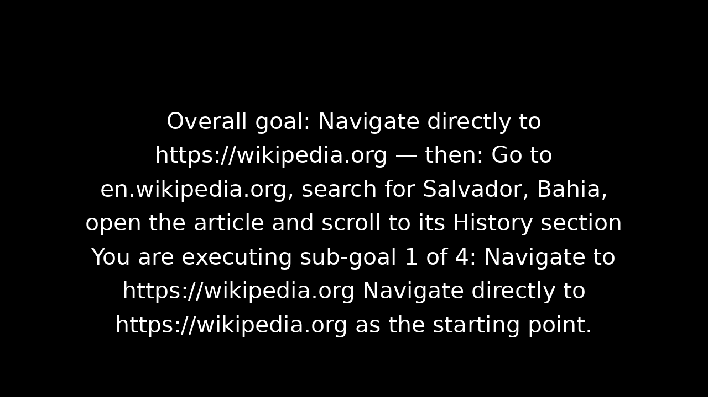
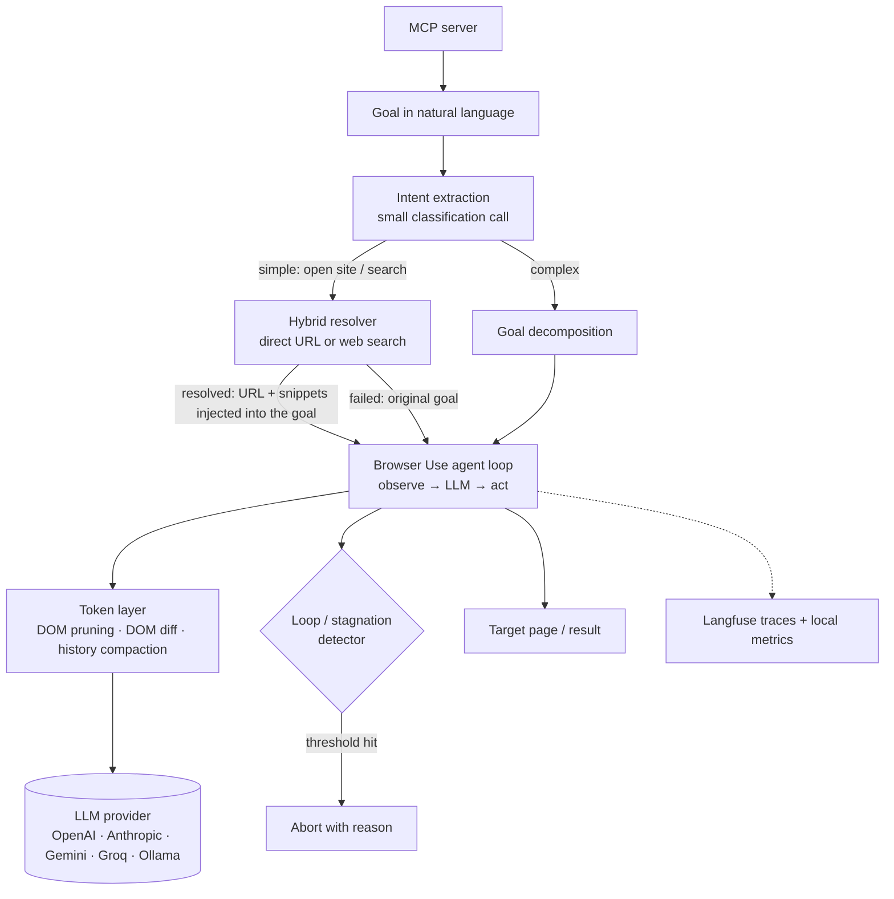

# Cobrowser: an autonomous browser agent, engineered for cost and reliability

> **TL;DR.** Cobrowser takes a goal in plain language ("open this site and find the first chapter") and drives a
> real browser until it's done. Most browser-agent demos stop at "it works once". This project is about the
> engineering after that: why an agent loops, where tokens go, how to stop paying for steps that don't need a model,
> and how to see all of it. It is built on Browser Use and Playwright, works with OpenAI, Anthropic, Gemini, Groq and
> Ollama, and is exposed as an MCP server so IDE agents can call it.

*A real run in text-only mode (`gpt-oss-120b` on Groq). You can see the hybrid resolver injecting the starting URL
("Navigate directly to…"), the goal split into sub-goals, and each step's decision.*

## The problem

A browser agent runs a loop. It observes the page (screenshot and/or DOM), asks an LLM what to do, acts, and
repeats. Every step is a full LLM call with a growing history. In practice this means:
- **Cost grows with every step.** A busy page can produce tens of thousands of characters of DOM per step.
- **Agents get stuck.** The model repeats the same action, and you pay for every repetition until `max_steps`.
- **There is little visibility.** Without traces you can't tell which step, prompt or page caused the problem.

## What I built

- **Goal runner** on top of Browser Use, with two modes: complete the task and close the browser, or *assist
  navigation*, which stops on the target page and hands it back to the user.
- **Hybrid resolver (fast path).** Before the browser loop starts, a small classification call extracts the
  intent. For simple goals, a direct URL (resolved with no network) or a web-search result, sometimes with page
  snippets, is injected into the goal. The agent then starts on the right page and needs fewer steps. If
  resolution fails, the agent runs with the original goal.
- **Token reduction layer:**
  - DOM pruning;
  - DOM diffing when the URL hasn't changed;
  - periodic history compaction;
  - a trimmed system prompt.

  Before the override, the system prompt alone was 47–63% of all tokens.
- **Loop abort.** Hard stop when the same action repeats N times or the page stays unchanged for N steps. It uses
  Browser Use's loop detector, which only warned the model before.
- **Goal decomposition** for long tasks, **navigation memory** for repeated goals, and **pre-login** from saved
  browser storage for sites behind authentication.
- **Provider-agnostic LLM factory:** OpenAI, Anthropic, Gemini, Groq and Ollama, plus a text-only mode for models
  without vision.
- **Observability:** Langfuse traces with spans per step, plus local metrics for tokens, latency and cost per step,
  and execution logs with the exact prompts.
- **MCP server** (stdio) so Copilot, Cursor or any MCP client can run browser goals from the IDE chat.

## Architecture

## Key technical decisions

**1. Diagnose from traces, then fix.**
One trace showed the cost of a stuck agent: 9 steps, 53,567 tokens, and the same action repeated 7 times until it
hit `max_steps`. Browser Use had detected the repetition, but only nudged the model, and the model ignored it. My
estimate was that stopping at step 4 would have saved ~30K tokens (56% of that run). That made the loop abort the
first fix, ahead of model routing or prompt tuning.

**2. Don't make the model search for what code can find.**
Many goals ("open X", "play Y") waste their first steps just finding the right page. The hybrid resolver does that
part in code, with one small classification call plus a direct URL or a web search, and injects the result into the
goal. It is designed to fail safe: if resolution fails, the agent gets the original goal. So the fast path can only
save steps, never break a task.

**3. Shrink the context, don't just pick a cheaper model.**
Cheaper models help, but tokens per step are the multiplier. I attacked them in four ways:
- pruning the DOM to the interactive elements;
- sending diffs when the page didn't navigate;
- compacting history every N steps;
- cutting the system prompt.

Text-only mode then lets the same flows run on non-vision models served by Groq or Ollama. A measured run with
`gemini-2.5-flash` in text-only mode finished a 4-step navigation for about US$0.014.

**4. Be honest about evaluation.**
A small benchmark of 8 runs had a 100% success rate. The project docs flag that as not statistically significant
and define the metrics needed before claiming reliability: success, done and stall rates, and memory hit rate per
site. I'd rather ship the measuring stick than a pretty number.

## What I'd do differently

- Build the golden-task benchmark (fixed goals, fixed sites, many runs) before optimizing, so every change is
  measured against the same baseline.
- Add model routing per step: a small model for routine actions and a larger one only when the agent is uncertain.

## Stack

Python · Browser Use · Playwright · LangChain · OpenAI / Anthropic / Gemini / Groq / Ollama · Langfuse · MCP (FastMCP) · DuckDuckGo search

*Source is private. Happy to walk through it on a call:
[LinkedIn](https://www.linkedin.com/in/willian-guedes) · willian.wg70@gmail.com.*
